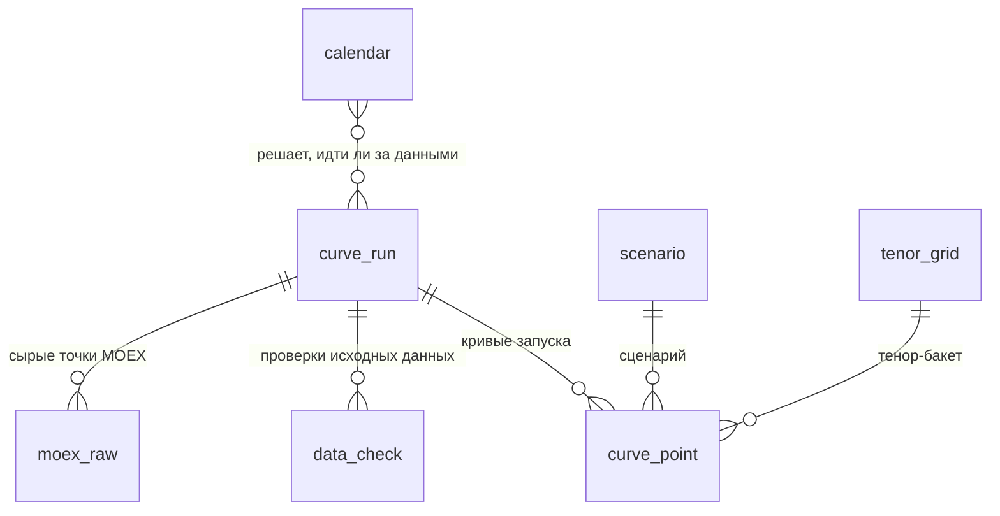

# Схема таблиц для кривых и истории запусков

Описание таблиц, в которые загрузчик записывает базовую и стрессовые кривые на дату и из которых их читает калькулятор.

## 1. Общая схема



Поток данных: **календарь** подсказывает, нужен ли запуск → загрузчик создаёт **запуск** (`curve_run`) и получает ответ MOEX → проверяет ответ и записывает результаты в `data_check` → при успешных проверках сохраняет числовые точки в `moex_raw` и рассчитывает **кривые** (`curve_point`) → калькулятор читает представление `curve_latest`.

## 2. Таблицы

### `scenario` (справочник сценариев)
| Поле | Тип | Описание |
|---|---|---|
| `scenario_id` | SMALLINT, ключ | 0 - базовая кривая, 1-6 - сценарии |
| `code` | TEXT | короткий код (`base`, `parallel_up` ...) |
| `name_ru` | TEXT | название по-русски |

Значения: 0 база, 1 параллельно вверх, 2 параллельно вниз, 3 увеличение наклона, 4 уменьшение наклона, 5 рост коротких, 6 снижение коротких (порядок как в Excel).

### `tenor_grid` (справочник 19 тенор-бакетов, таблица 1 8-МР)
| Поле | Тип | Описание | Пример |
|---|---|---|---|
| `tenor_label` | TEXT, ключ | метка тенора | `1.5y` |
| `order_no` | SMALLINT | порядок 1-19 | 7 |
| `interval_name` | TEXT | интервал ЦБ | от 1 до 1,5 года |
| `tenor_years` | NUMERIC(8,4) | тенор в годах (по нему определяется базовая ставка) | 1.5 |
| `t_mid_years` | NUMERIC(8,4) | срок до середины интервала (по нему считаются стрессы и коэффициенты) | 1.25 |

### `calendar` (календарь)
| Поле | Тип | Описание |
|---|---|---|
| `calendar_date` | DATE, ключ | дата |
| `is_working_day` | BOOLEAN | рабочий день (с учётом переносов) |
| `is_trading_day` | BOOLEAN | день торгов на бирже |
| `note` | TEXT | пояснение (например, название праздника) |

### `curve_run` (история запусков)
Одна строка на каждый запуск: ручной, по расписанию, пропущенный, неудачный.

| Поле | Тип | Описание | Пример |
|---|---|---|---|
| `run_id` | BIGSERIAL, ключ | ключ запуска | 125 |
| `report_date` | DATE | дата кривой, которую загружаем | 2026-07-31 |
| `run_type` | TEXT | `manual` или `scheduled` | `scheduled` |
| `started_at` / `finished_at` | TIMESTAMPTZ | время начала и конца | 2026-10-21 20:00 |
| `status` | TEXT | `running`, `success`, `error`, `no_data`, `skipped` | `success` |
| `error_message` | TEXT | текст ошибки или причина пропуска | MOEX не отвечает, 3 попытки |
| `started_by` | TEXT | кто запустил (пользователь или `scheduler`) | `scheduler` |

Статусы: `success` - кривая загружена и рассчитана; `error` - сбой (MOEX недоступна, ошибка расчёта); `no_data` - рабочий день, но данных нет; `skipped` - нерабочий день, не ходили за данными (не ошибка); `running` - запуск в процессе.

### `moex_raw` (сырые точки MOEX)
| Поле | Тип | Описание | Пример |
|---|---|---|---|
| `raw_id` | BIGSERIAL, ключ | служебный номер строки | 1 |
| `run_id` | BIGINT | запуск (внешний ключ) | 125 |
| `tenor_years` | NUMERIC(8,4) | срок точки MOEX, лет | 0.25 |
| `rate_pct` | NUMERIC(10,4) | доходность, % годовых | 13.59 |
| `moex_tradetime` | TIME | время публикации на MOEX | 18:49:59 |
| `loaded_at` | TIMESTAMPTZ | когда загрузили | 2026-10-21 20:00:03 |

### `data_check` (проверки исходных данных MOEX)
Одна строка на одно правило для каждого проверенного запуска. Результаты сохраняются и при успешной проверке, и при ошибке. Проверяется исходный ответ MOEX до записи в `moex_raw`: её числовые поля не позволяют сохранить отсутствующую или нечисловую ставку.

| Поле | Тип | Описание | Пример |
|---|---|---|---|
| `run_id` | BIGINT, внешний ключ на `curve_run.run_id` | запуск | 125 |
| `check_code` | TEXT | код правила: `tenors`, `rates`, `tradetime`, `report_date` | `tenors` |
| `status` | TEXT | результат: `ok` или `error` | `error` |
| `details` | TEXT | фактический результат или причина ошибки | Нет точки 20 лет |

Первичный ключ: (`run_id`, `check_code`). Для `check_code` и `status` задаются ограничения допустимых значений. Отсутствие строки означает, что правило не проверялось, а не что проверка прошла успешно.

Согласованные с заказчиком проверки:
1. `tenors`: присутствуют все 11 сроков MOEX — 0,25; 0,5; 0,75; 1; 2; 3; 5; 7; 10; 15; 20 лет.
2. `rates`: все ставки заданы, являются числами и находятся в пределах 0–50 % годовых.
3. `tradetime`: время среза MOEX (`moex_tradetime`) не раньше 18:30 по Москве. Время загрузки (`loaded_at`) не заменяет время среза; если время среза неизвестно, правило не отмечается как `ok`.
4. `report_date`: дата данных MOEX совпадает с запрошенной отчётной датой.

Если хотя бы одно правило вернуло `error`, расчёт не запускается: `curve_run.status = 'error'`, краткая причина записывается в `curve_run.error_message`. `success` допустим только после успешного завершения всех четырёх проверок и расчёта. Для запусков `skipped` и `no_data` строк в `data_check` может не быть, если данные MOEX не получены.

### `curve_point` (результат: кривые)
На один запуск: 19 тенор-бакетов × 7 кривых (база и 6 сценариев) = **133 строки**.

| Поле | Тип | Описание | Пример |
|---|---|---|---|
| `point_id` | BIGSERIAL, ключ | служебный номер строки | 1 |
| `run_id` | BIGINT | запуск (внешний ключ) | 125 |
| `report_date` | DATE | дата кривой (дублируется для быстрых запросов) | 2026-07-31 |
| `scenario_id` | SMALLINT | 0-6 | 3 |
| `tenor_label` | TEXT | метка тенора | `1.5y` |
| `tenor_years` | NUMERIC(8,4) | тенор в годах | 1.5 |
| `t_mid_years` | NUMERIC(8,4) | T, середина интервала | 1.25 |
| `rate_pct` | NUMERIC(10,6) | ставка кривой, % годовых | 12.451887 |
| `discount_factor` | NUMERIC(18,12) | коэффициент дисконтирования | 0.863558106848 |
| `method` | TEXT | как получена базовая ставка: `moex`, `nearest`, `interpolation`, `extrapolation` | `interpolation` |
| `is_interpolated` | BOOLEAN | значение получено интерполяцией | true |
| `is_extrapolated` | BOOLEAN | значение получено экстраполяцией | false |
| `calculated_at` | TIMESTAMPTZ | когда построена (рассчитана) эта строка кривой; при пересчёте обновляется | 2026-10-30 19:40:03+03 |

Ограничения: уникальность (`run_id`, `scenario_id`, `tenor_label`); флаги согласованы с `method` (`is_interpolated` = true только при `interpolation`, `is_extrapolated` - только при `extrapolation`).

### Представления для калькулятора
Калькулятор читает не сами таблицы, а два представления: в них всегда последний успешный запуск за дату (правило 2 в разделе 4).

**`curve_latest`** - длинный вид, одна строка = один бакет одной кривой. Поля: `report_date`, `run_id`, `scenario_id`, `scenario_code`, `tenor_label`, `order_no`, `tenor_years`, `t_mid_years`, `rate_pct`, `discount_factor`, `method`, `is_interpolated`, `is_extrapolated`, `calculated_at`.

**`curve_latest_wide`** - широкий вид, как в расчётном файле, одна строка = один тенор-бакет. Поля: `report_date`, `run_id`, `tenor_label`, `order_no`, `t_mid_years`, ставки `rate_base`, `rate_s1` ... `rate_s6` (база и сценарии 1-6) и коэффициенты `df_base`, `df_s1` ... `df_s6`, а также `method`, `is_interpolated`, `is_extrapolated` (как получена базовая ставка в этом тенор-бакете), `calculated_at` (время построения).

## 3. Формулы

- Ставки базовой кривой и сценариев: как в [`excel/readme.md`](../excel/readme.md).
- **Коэффициент дисконтирования:** `discount_factor = (1 + r)^(-T)`, где `r = rate_pct / 100`, `T = t_mid_years`.
- Поля `method`, `is_interpolated` и `is_extrapolated` описывают, как получена **базовая** ставка на этом теноре. У строк сценариев в том же тенор-бакете значения такие же, потому что стресс считается от базовой ставки.

Пример (31.07.2026, тенор `1.5y`, T = 1,25):

| Кривая | `rate_pct` | `discount_factor` |
|---|---|---|
| база (0) | 14.105 | 0.847947874430 |
| увеличение наклона (3) | 12.451887 | 0.863558106848 |

## 4. Правила

1. **Каждый запуск сохраняется навсегда**, повторный запуск на ту же дату создаёт новый `run_id`, старые строки не затираются.
2. **Что получает калькулятор:** кривая **последнего успешного запуска** (`status = 'success'`, максимальный `run_id`) за дату. Это представление `curve_latest` (длинный вид) и `curve_latest_wide` (широкий вид, как в расчётном файле).
3. **Нерабочий день:** по календарю запуск пропускается, пишется строка `status = 'skipped'` с причиной, ошибка не поднимается.
4. **Нет данных в рабочий день:** `status = 'no_data'`, в следующий рабочий день пробуем догрузить пропущенную дату.
5. **Сбой или ошибка исходных данных:** `status = 'error'` и текст в `error_message`. Результаты выполненных проверок сохраняются в `data_check`; при ошибке проверки расчёт не запускается. Калькулятору остаётся прошлый успешный запуск.
6. **Время построения:** в `curve_point.calculated_at` записывается, когда рассчитана кривая. Время загрузки точек с биржи хранится в `curve_run` и `moex_raw.loaded_at`. При ручном пересчёте `calculated_at` обновляется, поэтому видно, какой вариант кривой свежий.
7. **История для защиты:** ручные запуски за прошлые даты (`run_type = 'manual'`) и автоматические (`'scheduled'`) видны в `curve_run`.

## 5. Примеры запросов

```sql
-- Кривая на дату по сценарию 3 (увеличение наклона)
SELECT tenor_label, t_mid_years, rate_pct, discount_factor
FROM curve_latest
WHERE report_date = '2026-07-31' AND scenario_id = 3
ORDER BY order_no;

-- Все кривые за дату в широком виде
SELECT * FROM curve_latest_wide
WHERE report_date = '2026-07-31'
ORDER BY order_no;

-- Выгрузка кривых за дату с временем построения и данными о запуске
SELECT cl.report_date, cl.scenario_id, cl.tenor_label, cl.rate_pct, cl.discount_factor,
       cl.calculated_at, cr.run_type, cr.started_by, cr.started_at
FROM curve_latest cl
JOIN curve_run cr USING (run_id)
WHERE cl.report_date = '2026-10-30'
ORDER BY cl.scenario_id, cl.order_no;

-- История запусков за последние дни
SELECT run_id, report_date, run_type, status, started_at, error_message
FROM curve_run
ORDER BY run_id DESC
LIMIT 20;
```

## 6. Доступ

- `loader_rw` - загрузчик: чтение и запись в таблицы запусков и кривых.
- `calc_ro` - калькулятор: **только чтение** (представления `curve_latest`, `curve_latest_wide` и таблицы запусков).
- Пароли не хранятся в репозитории, а задаются через переменные окружения при развёртывании.
